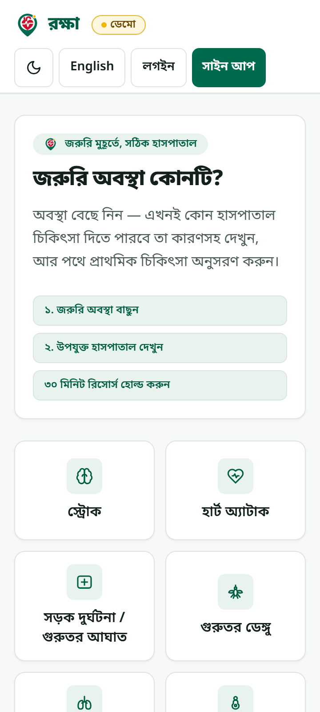
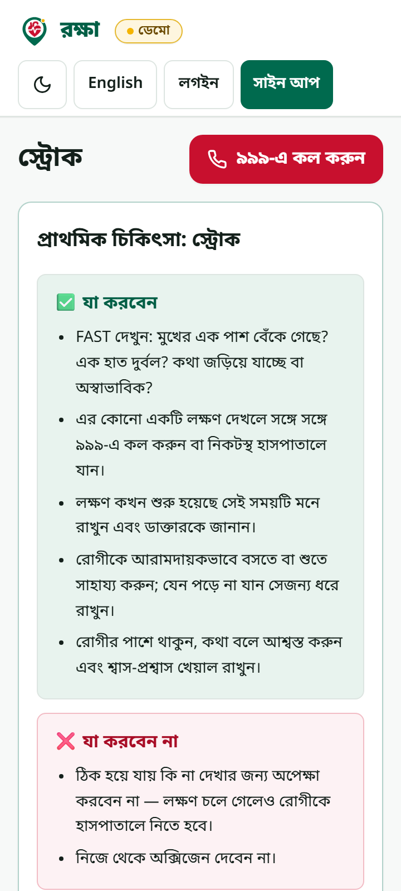
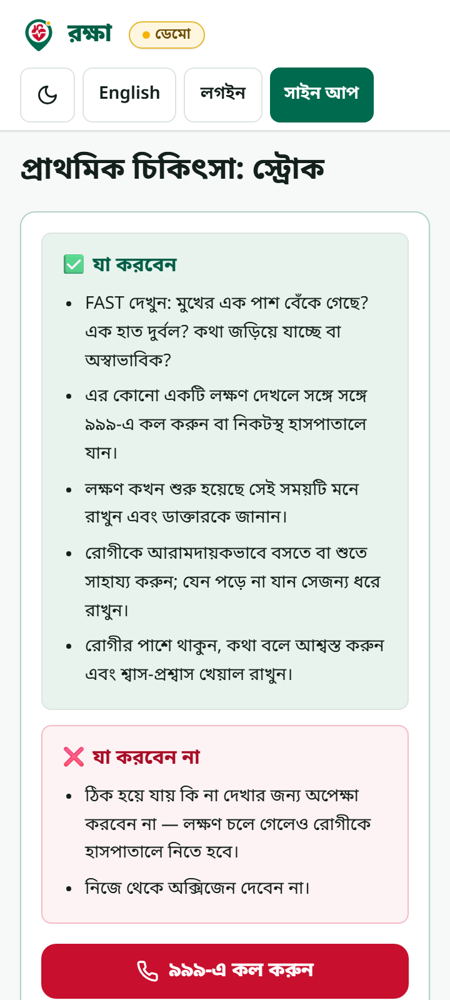
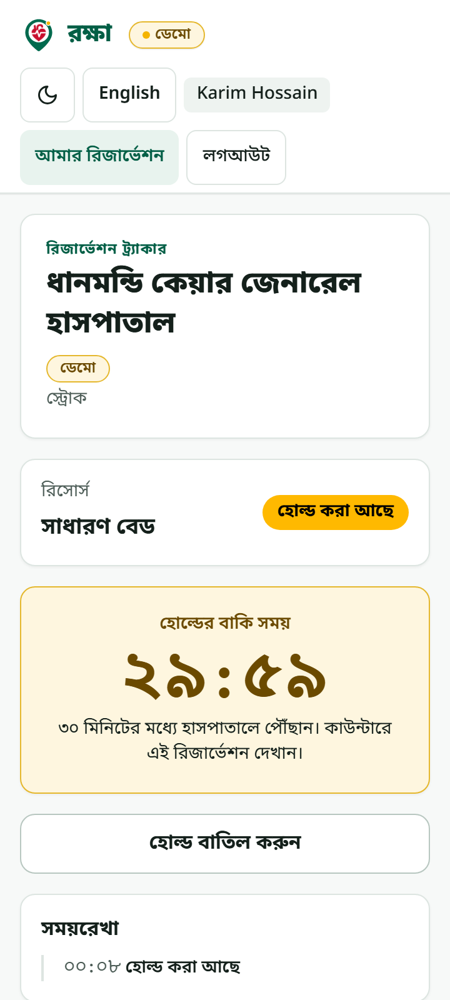
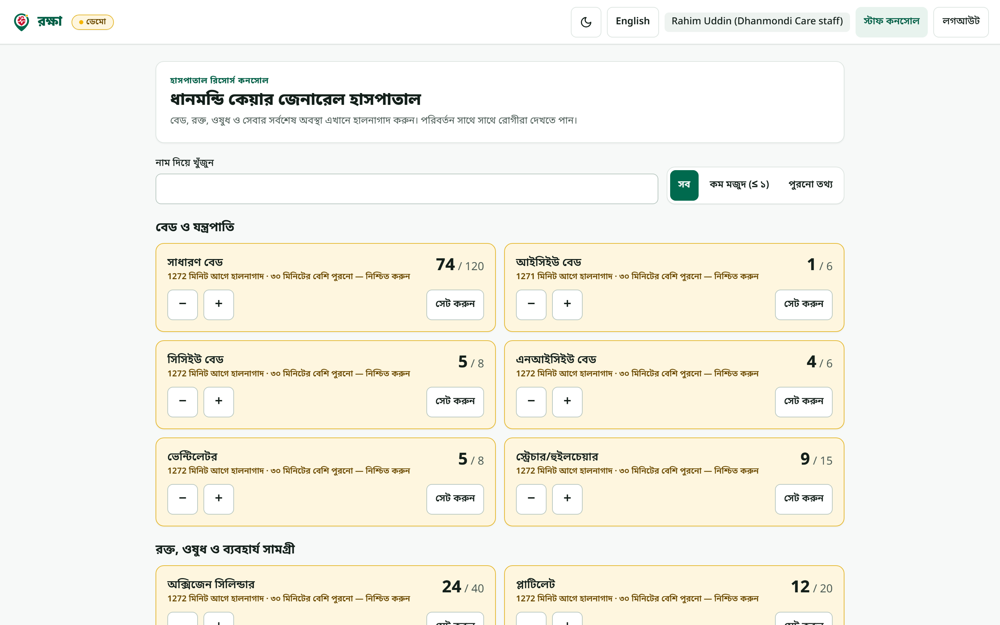
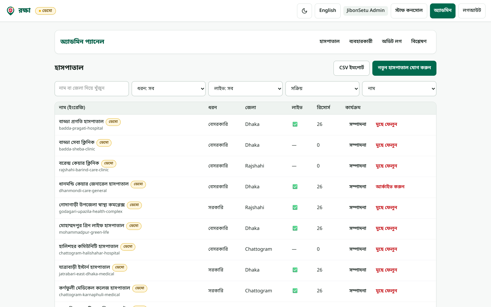

<div align="center">


# Rokkha (রক্ষা)

### জরুরি মুহূর্তে, সঠিক হাসপাতাল
**The right hospital, right when it matters.**

Live emergency healthcare finder, concurrency-safe resource reservation, and a sourced first-aid guide for Bangladesh.

[](https://web-production-3fb89dc8.up.railway.app)
[](TODO_YOUTUBE_URL)
[](#submission-summary)


[Live App](https://web-production-3fb89dc8.up.railway.app) · [Video Demo](TODO_YOUTUBE_URL) · [Judge Guide](docs/JUDGE_GUIDE.md) · [Architecture](docs/ARCHITECTURE.md) · [Testing](docs/TESTING.md)

</div>

> *Formerly JibonSetu.* Repository: https://github.com/irfanulhoquetaseen/jibonsetu

> **Demo Notice:** Seeded hospitals are fictional facilities (`isDemo = true`) and do not represent real hospital availability. They are marked with a `"ডেমো"` / `"Demo"` badge in the header and on each demo hospital card.

## Table of Contents

- [Screenshots](#screenshots)
- [Highlights](#highlights)
- [Submission Summary](#submission-summary)
- [The Problem & Who It's For](#the-problem--who-its-for)
- [What It Does](#what-it-does-interconnected-3--1-modules)
- [Rubric Verification Map](#rubric-verification-map)
- [Advanced Challenges (A05 & A01)](#advanced-challenges-deep-dive-a05--a01)
- [Tech Stack](#tech-stack--architecture-summary)
- [Run Locally](#run-locally)
- [Demo Accounts](#demo-accounts)
- [Limitations & Decisions](#limitations--decisions)
- [Rollout & Future Work](#real-world-rollout--future-work)

## Screenshots

<table>
  <tr>
    <td align="center"><br /><sub><b>Home</b>: 8 emergencies, one tap to 999</sub></td>
    <td align="center"><br /><sub><b>Finder</b>: ranked hospitals with reasons</sub></td>
    <td align="center"><br /><sub><b>First aid</b>: bilingual, WHO/IFRC sourced</sub></td>
    <td align="center"><br /><sub><b>Tracker</b>: 30-minute live hold</sub></td>
  </tr>
</table>

<table>
  <tr>
    <td align="center"><br /><sub><b>Hospital console</b>: stock and live reservation queue</sub></td>
    <td align="center"><br /><sub><b>Admin</b>: hospitals, users, audit, analytics</sub></td>
  </tr>
</table>

## Highlights

- **Find in seconds:** public, no-login triage across 8 emergency conditions, ranking hospitals 0-100 by clinical capability, distance and data freshness, with plain-language reasons.
- **Hold, don't hope:** atomically reserve an ICU bed, blood or antivenom for 30 minutes. 20 parallel requests for 1 bed give exactly **1 HELD and 19 SOLD_OUT** (A05).
- **Always live:** every hold and stock change reaches citizens, staff and admins in under a second over authorized Socket.io rooms (A01).
- **First aid on the way:** bilingual Do's/Don'ts sourced from IFRC 2020 and WHO, with a medical disclaimer.
- **Built for real phones:** Bangla by default, light/dark themes, 44 px touch targets, no horizontal overflow at 360 px.
- **Secure by default:** own session auth, rate limits, Origin checks, 404-not-403 guards and a full audit log.

---

## Submission Summary

| Field | Details |
|---|---|
| **Project Title** | Rokkha (রক্ষা), formerly JibonSetu |
| **Selected Track** | World Problem Solver |
| **Advanced Challenges** | **A05** Concurrency & Transaction Management · **A01** Real-Time Data Synchronization |
| **Problem Statement** | During medical emergencies in Bangladesh, families waste critical minutes going hospital to hospital without knowing where an ICU bed, compatible blood bag, antivenom, rabies vaccine, or on-duty specialist is actually available. Rokkha ranks nearby facilities by live clinical capability, distance, and freshness, lets citizens atomically hold a needed resource for 30 minutes, and synchronizes every hold and triage update live between citizens, hospital staff, and administrators. |
| **Intended Users** | Families and bystanders in emergencies (public, no login to search), hospital staff managing beds/specialists/arrivals, and platform administrators overseeing hospitals, users, audit logs, and unmet demand. |

---

## The Problem & Who It's For

In critical emergencies, uncertainty costs lives:

- **Stroke & cardiovascular emergencies:** WHO Global Health Estimates and IHME Global Burden of Disease data rank stroke and ischemic heart disease as leading causes of death in Bangladesh, where immediate triage to a facility with an active CT scan and neurologist determines survival.
- **Snakebite mortality:** Bangladesh sees **about 890,000 bites and about 7,500 deaths a year (DGHS National Survey on Annual Incidence and Epidemiology of Snakebite in Bangladesh)**, heavily driven by delays reaching facilities stocked with antivenom.
- **2026 rabies vaccine shortages:** Reporting across Bangladesh in 2026 (Dhaka Tribune, The Business Standard) documented recurring anti-rabies vaccine stockouts across public hospitals, forcing animal-bite victims to travel long distances across facilities or pay out of pocket before symptoms develop.

**Who it serves:**
1. **Citizens & families:** Instant emergency search without login, bilingual first aid while en route, one-tap `Call 999`, and 30-minute resource holds.
2. **Hospital staff:** One-click stock adjustments (`+`/`−`, Set, specialist/equipment toggles) and a live reservation check-in queue.
3. **Administrators:** Hospital lifecycle CRUD/archive, CSV bulk import, role assignments, audit trail inspection, and SQL demand analytics.

---

## What It Does (Interconnected 3 + 1 Modules)

1. **Emergency Finder (`/`, `/find`, `/first-aid/[condition]`, `/hospitals/[hospital]`)** — Public, zero-login triage across **8 data-driven emergency conditions** (`STROKE`, `HEART_ATTACK`, `TRAUMA`, `DENGUE`, `BREATHING`, `PREGNANCY`, `SNAKEBITE`, `ANIMAL_BITE`). Ranks hospitals `0–100` using a **generic 26-type resource catalog** (`19` countable resources + `7` live on/off status services/specialists) and a `27`-row red-cell `BloodCompatibility` matrix. Includes bilingual Do's/Don'ts sourced from **IFRC International First Aid Guidelines 2020** and **WHO** fact sheets (with explicit source links and medical disclaimer), plus a `"Unverified — call before going"` directory for non-live hospitals (`5` seeded). Demo phone numbers disable `tel:` dialing; only `Call 999` dials, and a header `"Demo"` / `"ডেমো"` badge + popover clearly marks fictional facilities.
2. **Reservation & Case Tracker (`/reservations`, `/reservations/[reservationId]`)** — Signed-in citizens hold a countable resource for **30 minutes** (`1` hold per resource type, `2` active holds max). Holds decrement stock atomically in Module 3, update public Finder counts in Module 1, and stream staff transitions (`HELD → ARRIVED → COMPLETED / REJECTED / EXPIRED`) back to the citizen tracker without reloads.
3. **Hospital Resource Console (`/staff`, `/staff/hospitals/[hospitalId]`)** — Strictly scoped to one assigned hospital (`HOSPITAL_STAFF` gets HTTP `404` on any other hospital). Supports `+`/`−`, `Set`, specialist/equipment switches with optimistic concurrency (`409 CONFLICT`), and a searchable/filterable reservation queue (`Check in`, `Reject` with reason, `Complete`).
4. **Admin Panel (`/admin`, `/admin/users`, `/admin/audit`, `/admin/analytics`)** — `ADMIN`-only management with search/filter/sort CRUD, safe hard-delete vs. `archivedAt` soft-archive (hidden from Finder, alternatives, `/hospitals/<slug>`, and `reserve()`), RFC-4180 CSV import, `CITIZEN ↔ HOSPITAL_STAFF` role changes (revoking live sessions + sockets), audit log filtering, SQL-aggregated demand/unmet-demand analytics, and hold-aware demo stock refresh.

---

## Rubric Verification Map

Walk-through scripts for all items are in [`docs/JUDGE_GUIDE.md`](docs/JUDGE_GUIDE.md).

| Rubric | Implementation | Under-1-Minute Live Check |
|---|---|---|
| **M01** Complete Functional System | `src/app/find/`, `src/app/reservations/`, `src/app/staff/`, `src/app/admin/` | Pick condition on `/find` → hold bed into `/reservations/[id]` → watch `/staff` queue update → check in / complete to update citizen tracker end to end. |
| **M02** Database Integration & Persistence | `prisma/schema.prisma`, `prisma/migrations/`, `src/server/admin/hospitals.ts`, `src/server/reservations/reserve.ts`, `src/server/resources/update.ts` | On `/admin`, create, edit, and delete or archive a hospital; hold a bed on `/find`; adjust stock on `/staff` and reload to verify PostgreSQL persistence, FKs, and constraints. |
| **M03** Authentication & Authorization | `src/server/auth/`, `src/server/admin/page-guard.ts`, `src/proxy.ts`, `src/server/audit/` | Signed-out `/staff` or `/admin` returns `307 /login?next=...`; Dhanmondi staff opening Mirpur `/staff/...` or citizen opening `/admin` returns real HTTP **404** + `AUTHZ_DENIED` audit. |
| **M04** Complex Business Logic | `src/server/matching/`, `prisma/data/blood.ts`, `src/server/reservations/{reserve,state-machine,transition}.ts`, `src/server/admin/hospitals.ts` | Search `/find?condition=TRAUMA&blood=A_NEG` (blood donor matrix + `CRITICAL`/`PREFERRED` rules); test 1-per-type hold cap (`LIMIT_REACHED`), CAS transitions, and active-hold archive block (`409`). |
| **M05** Dynamic Data Processing | `src/server/finder/search.ts`, `src/server/matching/rank.ts`, `src/server/admin/{hospitals,users,audit-viewer,analytics,csv-import}.ts` | Search, filter (`Govt`/`Resource`/`Radius`), sort, and paginate `/find` (scores `0–100`); inspect SQL-aggregated demand, sold-out counts, rates, avg hold→arrival, and stale hospitals on `/admin/analytics`. |
| **M06** Error & Edge-Case Handling | `src/lib/errors.ts`, `src/server/reservations/{reserve,alternatives}.ts`, `src/server/admin/csv-import.ts`, `src/components/realtime/` | Double-click Hold (idempotency returns 1 hold), reserve `0`-stock row (`409 SOLD_OUT` + 3 alternatives), hit `409` staff conflict or CSV row errors, `/first-aid/NOPE` → 404, DevTools offline → online recovery. |
| **M07** Responsive UI & Accessibility | `src/app/layout.tsx`, `src/components/`, `src/lib/i18n/`, `src/lib/validation/phone.ts` | Inspect `/`, `/find`, `/staff`, `/admin` at `360×800` & `1440×900` (`0` overflow, `≥ 44 px` touch targets, `<label>`/`role="alert"` semantics), test `12345` phone validation, toggle `বাংলা ↔ English` and light/dark theme, verify the header `Demo` popover & cited first aid. |
| **M08** Deployment & Documentation | `server.ts`, `src/app/api/health/route.ts`, `package.json`, `scripts/demo-race.ts`, `README.md`, `docs/` | Open live Railway `/api/health` (`{"status":"ok","db":"up"}`) and `/status` (Socket.io connected), and follow [`docs/ARCHITECTURE.md`](docs/ARCHITECTURE.md), [`docs/JUDGE_GUIDE.md`](docs/JUDGE_GUIDE.md), and [`docs/TESTING.md`](docs/TESTING.md). |
| **A05** Concurrency & Transaction Management | `src/server/reservations/{reserve,transition,stock,sweeper,state-machine}.ts`, `src/server/admin/hospitals.ts` | Run `npm run demo:race -- --url https://web-production-3fb89dc8.up.railway.app --hospital dhanmondi-care-general --resource ICU_BED --n 20 --set-available 1` → **1 HELD, 19 SOLD_OUT**. |
| **A01** Real-Time Data Synchronization | `src/server/realtime/{io,rooms,registry,publish}.ts`, `src/components/realtime/` | Hold in Window A → Window B `/find` updates `< 1 s`; edit same row in two `/staff` tabs → `409 CONFLICT` Reload/Re-apply UI. |

---

## Advanced Challenges Deep-Dive (A05 & A01)

### A05 — Concurrency & Transaction Management
- **One transaction (`reserveTx`)** in [`src/server/reservations/reserve.ts`](src/server/reservations/reserve.ts): acquires `pg_advisory_xact_lock(hashtextextended(userId, 0))` to serialize per-user races, checks `Idempotency-Key` + `requestHash`, verifies hospital/resource & `archivedAt IS NULL`, enforces per-user hold caps (`1` per type, `2` active total), executes an atomic conditional decrement (`UPDATE "HospitalResource" SET available = available - qty, version = version + 1 WHERE id = ? AND available >= qty` — never read-then-write), records `SoldOutEvent` once on `0` rows (returning `409 SOLD_OUT` with ≤ 3 alternatives), re-checks `Hospital.archivedAt` while holding the stock row lock, and writes `Reservation` + `ReservationEvent` + `AuditLog`.
- **Database defense in depth:** `CHECK ("available" >= 0 AND "available" <= "total")`, `CHECK ("quantity" > 0)`, partial unique index `reservation_one_active_per_type` on `(userId, resourceTypeId) WHERE status IN ('HELD', 'ARRIVED')`.
- **Compare-and-set state machine & expiry:** `transitionReservation()` executes `UPDATE ... WHERE id = ? AND status = <expected>` so parallel `cancel` / `reject` / `checkIn` / `expire` races yield exactly one winner and `409 INVALID_TRANSITION` for losers. Returned stock clamps `LEAST("total", "available" + qty)` and omits consumables on `COMPLETED`. Overdue holds expire on boot, every `30 s` (`startExpirySweeper`), and lazily on reads/reserves. Archive (`deleteOrArchiveHospital`) locks `HospitalResource ... FOR UPDATE` before counting holds so archiving and reserving never collide.
- **Measured:** Live `demo:race` with **20 parallel requests for 1 ICU bed → `1 HELD, 19 SOLD_OUT`** in `325 ms` (final stock `0`); `5` beds → `5 HELD, 15 SOLD_OUT` in `452 ms`. All `313 / 313` Vitest unit & integration tests pass against real PostgreSQL.

### A01 — Real-Time Data Synchronization
- **Authorized Socket.io rooms (`server.ts`, `src/server/realtime/`):** Shares one HTTP port with Next.js (`/socket.io`). Cross-origin handshakes are rejected (`allowRequest`); session cookies resolve at handshake and re-validate on every `subscribe`. Public rooms (`finder`, `hospital:{id}`) carry stock only; `staff:{hospitalId}` and `reservation:{id}` enforce `requireHospitalAccess` / `requireReservationOwner`; private `session:{sha256}` rooms disconnect sockets immediately on logout, expiry, or role change.
- **Emit after commit & version gating:** `publishStock` and `publishReservation` fire only **after** Prisma `$transaction` resolves (zero PII on the wire). Clients gate events by entity `version` (`event.version <= held` dropped, snapshot accepted when `version >= held`), coalesce bursts (`300 ms` / `1000 ms` maxWait), show a `"Reconnecting…"` banner on disconnect, and refetch snapshots on reconnect or browser `online`.
- **Optimistic staff concurrency:** Staff updates require matching `version` in Postgres; mismatches return `409 CONFLICT` with current server values (`ConflictPanel`: **Reload** or **Re-apply**), while open edited `Set` forms freeze against live overwrites and display an inline warning.
- **Measured live latency (`Browser A hold → Browser B Finder`):** **`424 ms` mobile / `439–446 ms` desktop** (P4+P5 acceptance run); **`810 ms` mobile / `789 ms` desktop** (post-P6 full run, well under the `< 1 s` target).

---

## Tech Stack & Architecture Summary

Next.js `16.4` (App Router, React `19.3`, TypeScript `strict`), Tailwind CSS `4`, Prisma `7.10` (`@prisma/adapter-pg`), PostgreSQL `18`, Zod `4`, `bcryptjs`, Socket.io `4.8`, Vitest `5`, and Playwright `1.65`. `server.ts` runs Next.js, Socket.io, and the 30-second expiry sweeper in a single long-lived Node `24` process on Railway Singapore, keeping database round trips inside `src/server/*` domain services and validating every input and state transition server-side. See [`docs/ARCHITECTURE.md`](docs/ARCHITECTURE.md) for system, sequence, state-machine, and ER diagrams.

---

## Run Locally

**Prerequisites:** Node.js `>= 24` (`engines.node` in `package.json`) and a PostgreSQL 18 database (plus a second empty database whose name ends in `_test` for integration/E2E tests).

1. **Install & configure environment:**

```powershell
# Windows PowerShell
npm install
Copy-Item .env.example .env
```

```bash
# macOS / Linux
npm install
cp .env.example .env
```

Fill `.env` with your local values (refer to `.env.example`):

| Variable | Purpose |
|---|---|
| `DATABASE_URL` | PostgreSQL URL for Next.js runtime, migrations, and seeding |
| `DATABASE_URL_TEST` | Separate PostgreSQL URL for integration/E2E tests (**DB name must end with `_test`**) |
| `PORT` / `HOST` | Listen port (default `3000`) and bind host (`localhost` dev / `0.0.0.0` prod) |
| `NODE_ENV` | `"production"` for `npm start`; unset in local dev |
| `BASE_URL` | Optional deployed URL for running Playwright E2E against live (`playwright.config.ts`) |
| `LOGIN_LIMIT_PER_PHONE`, `LOGIN_LIMIT_PER_IP`, `SIGNUP_LIMIT_PER_IP`, `RESERVE_LIMIT_PER_USER` | Optional positive integer overrides for auth/reserve rate limits (defaults: `5`, `30`, `10`, `20`) |
| `SEED_ADMIN_PASSWORD`, `SEED_STAFF_PASSWORD`, `SEED_CITIZEN_PASSWORD` | Demo seed passwords (min 8 chars each, max 72 UTF-8 bytes) |
| `SEED_RESET_STOCK` | Optional `"1"` to reset demo hospital stock (hold-aware) during `npm run db:seed` |
| `E2E_PORT` | Optional local Playwright dev-server port (default `3100`) |

2. **Migrate, seed, and start dev server:**

```powershell
npm run db:migrate
npm run db:seed
npm run dev   # http://localhost:3000
```

3. **Run tests** (integration tests enforce the `_test` DB name guard so `DATABASE_URL` is never truncated):

```powershell
npm test -- --reporter=dot   # Unit + real-Postgres integration (34 files, 313 tests)
npm run typecheck            # next typegen && tsc --noEmit
npm run lint                 # eslint .
npm run test:e2e             # Playwright mobile (360x800) + desktop (1440x900)
```

See [`docs/TESTING.md`](docs/TESTING.md) for the full test breakdown.

**Railway deployment notes:** App and PostgreSQL run in **Railway Singapore** (`ap-southeast`), single always-on instance (no serverless sleep so Socket.io connections and the 30 s sweeper remain live). Pre-deploy executes `npm run db:deploy` (`prisma migrate deploy`), runtime executes `npm start` (`NODE_ENV=production node dist/server.mjs`) via the internal Railway Postgres URL, and live env sets `LOGIN_LIMIT_PER_IP=300` so judges sharing an IP behind NAT are not rate-limited (per-phone limit remains `5`).

---

## Demo Accounts

| Role | Phone (Username) | Scope |
|---|---|---|
| Admin | `01700000001` | Platform admin (`/admin`, `/staff`) |
| Hospital Staff | `01700000011` | Dhanmondi Care General Hospital (`/staff`) |
| Hospital Staff | `01700000012` | Mirpur Shastho Medical College Hospital (`/staff`) |
| Citizen | `01700000021`, `01700000022`, `01700000023` | Citizen finder & reservations (`01700000101`–`01700000120` reserved for `npm run demo:race`) |

Passwords are provided to judges privately with the submission.

---

## Limitations & Decisions

- **Demo dataset & staleness:** All 25 seeded hospitals are fictional (`isDemo = true`), clearly indicated by the header `Demo` badge, per-card `Demo` tag, and disabled `tel:` links; stock timestamps age (`> 30 min`) between sessions unless refreshed via `/admin` (**Refresh demo stock**) or `SEED_RESET_STOCK=1`.
- **Single-instance in-memory rate limits:** Works accurately on one Railway Node instance; scaling horizontally would require moving counters to Postgres or Redis. Per-phone limiting (`5 / 15 min`) can temporarily lock one account on repeated wrong guesses.
- **In-memory matching pass:** `searchHospitals` fetches and scores live active hospitals in JS per query (fast for 20 live hospitals; larger directories would push bounding-box prefiltering into SQL/PostGIS).
- **Known minor items:** Bangla first-aid copy still awaits native-speaker medical proofreading; live-URL Lighthouse mobile audits scored **Performance 100 / Accessibility 100** on `/` (`LCP 1.0 s`, `CLS 0`) and **Performance 100 / Accessibility 100** on `/find?condition=STROKE` (`LCP 1.1 s`, `CLS 0`, non-polyfill initial JS `148.6 KB` gzip — see [`docs/reports/lighthouse-find-mobile.json`](docs/reports/lighthouse-find-mobile.json)); untouched open staff `Set` forms re-key on incoming socket updates; and `"X is editing"` staff presence was skipped.

---

## Real-World Rollout & Future Work

**Real-world rollout path:** Onboard verified facilities from the official registry (`isDemo = false`, real phone dialing enabled), bind verified hospital coordinators (`HOSPITAL_STAFF` via `/admin/users`), elevate `FirstAidGuide.reviewStatus` from `SOURCE_CHECKED` to `MEDICALLY_REVIEWED` with clinician sign-off, externalize Socket.io pub/sub & rate-limit state to Redis for multi-instance horizontal scaling, and introduce SMS OTP verification.

**Future work:**
- *Deferred platform features:* Admin CRUD editors for `Condition`, `ConditionRequirement`, and `FirstAidGuide`; paginated all-hospital directory browsing; PWA web manifest + service worker caching `/first-aid/*` for offline access; live staff presence indicators; automated Lighthouse CI verification.
- *Out-of-scope product extensions:* Ambulance dispatch integration, pharmacy stock lookup, outpatient doctor appointments, community blood donor network, SMS/OTP delivery, hospital EHR integrations, and billing/payments.
