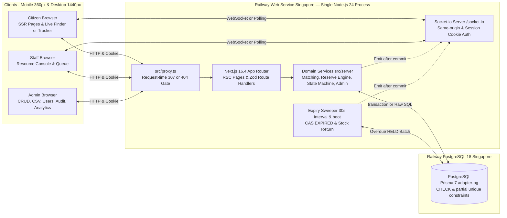
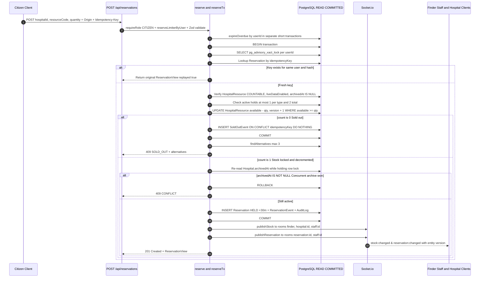
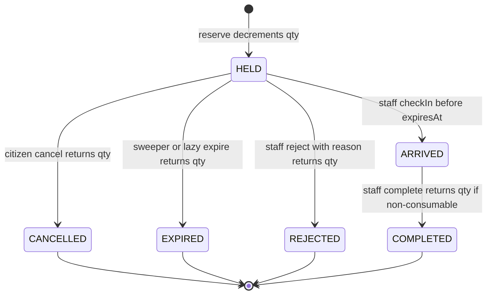
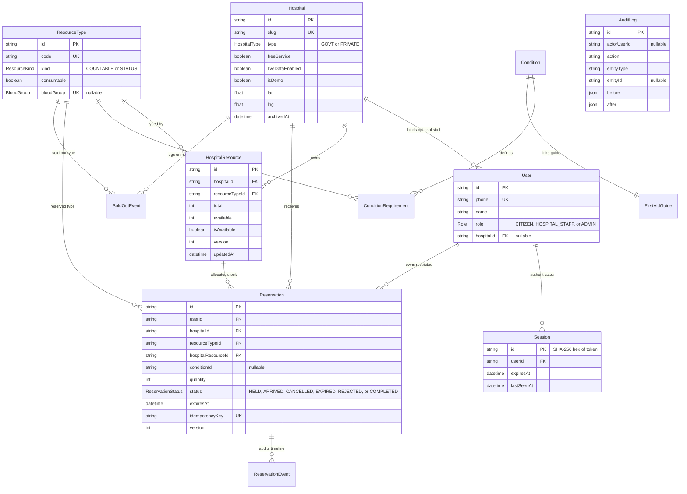

# JibonSetu Architecture

JibonSetu runs as a single long-lived Node.js 24 process hosting Next.js 16 (App Router), Socket.io 4.8, and an in-process reservation expiry sweeper against PostgreSQL 18 via Prisma 7.

---

## 1. System Components



---

## 2. Reservation Flow & Concurrency Control (A05)

Every reservation request executes `expireOverdue` for that user's overdue holds (each in its own short transaction so crossed overdue holds on two rows cannot deadlock), then runs `reserveTx` inside a single `prisma.$transaction`:



### Archive-vs-Reserve Mutual Exclusion
- `deleteOrArchiveHospital()` (`src/server/admin/hospitals.ts`) expires overdue holds for that hospital, then inside its transaction locks every `HospitalResource` row (`SELECT "id" FROM "HospitalResource" WHERE "hospitalId" = $1 ORDER BY "id" FOR UPDATE`) **before** counting active holds or setting `archivedAt`.
- `reserveTx` (`src/server/reservations/reserve.ts`) takes a row lock on `HospitalResource` during conditional `takeStock`, and immediately re-reads `Hospital.archivedAt` within the same transaction before inserting the reservation.
- Under PostgreSQL `READ COMMITTED`, whichever transaction acquires the lock first forces the other to wait and observe its commit, preventing an archived hospital from ever holding an active `HELD` reservation.

---

## 3. Reservation State Machine

Defined purely in `src/server/reservations/state-machine.ts` and executed via compare-and-set (`UPDATE ... WHERE id = ? AND status = <expected>`) in `src/server/reservations/transition.ts`:



- Returned stock is always clamped: `SET available = LEAST("total", "available" + qty)` so staff lowering `total` while a hold is active never violates `available <= total`.
- Any invalid transition (including double check-in or cancelling an expired hold) yields `409 INVALID_TRANSITION` (`count === 0` from the CAS update).

---

## 4. Entity Relationship Diagram



Unlinked support tables in `prisma/schema.prisma`: `BloodCompatibility` (`@@id([donor, recipient])`, 27 red-cell rows) and `SystemHeartbeat` (`SELECT 1` / boot write probe).

---

## 5. Folder Structure

- `server.ts` — Custom Node HTTP server running Next.js App Router, Socket.io (`/socket.io`), and the 30-second expiry sweeper on one port.
- `prisma/` — `schema.prisma`, 6 SQL migrations (`prisma/migrations/`), `seed.ts`, and static reference datasets (`prisma/data/{blood,conditions,first-aid,hospitals,resource-types}.ts`).
- `scripts/demo-race.ts` — HTTP-only concurrency demonstrator (`npm run demo:race`) firing parallel hold requests against demo hospitals and automatically cleaning up.
- `src/proxy.ts` — Request-time routing guard giving real HTTP `307` / `404` status codes before React streaming starts.
- `src/app/` — App Router pages (`(auth)`, `find`, `first-aid/[condition]`, `hospitals/[hospital]`, `reservations`, `staff`, `admin`, `status`) and REST route handlers (`src/app/api/**`).
- `src/server/` — Server-only domain modules:
  - `auth/` (sessions, passwords, guards, rate-limiting, signup/login)
  - `matching/` (pure ranker, Haversine geo)
  - `finder/` (search params, condition/directory lookup, Dhaka/Chattogram/Rajshahi areas)
  - `reservations/` (engine, CAS transitions, stock helpers, sweeper, alternatives, schemas)
  - `resources/` (staff stock queries & optimistic versioned updates)
  - `realtime/` (Socket.io attachment, room auth, session disconnect registry, post-commit publishers)
  - `admin/` (hospital CRUD/archive, RFC-4180 CSV import, user role changes, SQL analytics, audit viewer, demo stock refresh)
  - `audit/`, `http/`, `i18n/`, `seed/`
- `src/components/` — Accessible mobile-first UI islands (`finder/`, `hospital/`, `reservations/`, `staff/`, `admin/`, `auth/`, `realtime/`).
- `src/lib/` — Shared Zod phone validation, CSV parser, typed `bn`/`en` dictionaries (`src/lib/i18n/`), unified `AppError` helpers (`src/lib/errors.ts`), wire event types (`src/lib/realtime-types.ts`).
- `tests/` — Vitest `unit/`, Postgres-backed `integration/`, Playwright `e2e/`, and `support/` (`test-db-guard.ts`, fixtures, DB reset).

---

## 6. Data Model & Database Defenses

Beyond Prisma foreign keys (`Reservation.userId` uses `ON DELETE RESTRICT`), custom SQL migrations enforce invariants directly in PostgreSQL:
- `hospital_resource_stock_bounds`: `CHECK ("available" >= 0 AND "available" <= "total" AND "total" >= 0)`
- `reservation_quantity_positive`: `CHECK ("quantity" > 0)`
- `condition_requirement_target`: `CHECK (("resourceTypeId" IS NOT NULL) <> "isBlood")`
- `hospital_coords_valid`: `CHECK ("lat" BETWEEN -90 AND 90 AND "lng" BETWEEN -180 AND 180)`
- `reservation_one_active_per_type`: Partial unique index `ON "Reservation"("userId", "resourceTypeId") WHERE "status" IN ('HELD', 'ARRIVED')`
- Query & sort indexes: `(hospitalId, status, expiresAt)`, `(hospitalId, createdAt)`, `(userId, createdAt)`, `(status, expiresAt)`, `Hospital(archivedAt)`, `Hospital(district, type, liveDataEnabled, freeService)`.

Generic data-driven resource catalog: 26 seeded `ResourceType` rows (`19` countable beds, equipment, blood groups, platelets, antivenom, rabies vaccine, RIG; `7` boolean status services/specialists) linked dynamically via `ConditionRequirement` across 8 emergency conditions.

---

## 7. Matching Engine (`src/server/matching/rank.ts`)

Pure, deterministic scoring on a `0–100` scale:

| Factor | Max Points | Rule |
|---|---|---|
| Capability | **70** | `CRITICAL` requirement weight **3**, `PREFERRED` weight **1**. Score = `70 * metWeight / totalWeight` (`70` if no requirements). Blood requirements query `BloodCompatibility` for the patient's group; unknown blood group counts **`O_NEG` only**. |
| Distance | **20** | Haversine distance (`EARTH_RADIUS_KM = 6371`). Score = `20 * max(0, 1 - km / 30)` (`0` beyond 30 km). Flat **`10` points** when origin is omitted. |
| Freshness | **10** | Checks the **oldest** `updatedAt` among the resource rows inspected for the condition's requirements. Within `STALE_AFTER_MS` (`30 min`) → **10**; older → **0** + amber warning (`⚠️ N min ago`). |

- Any missing `CRITICAL` requirement marks `suitable = false`.
- Default sort puts all `suitable = true` hospitals first, then `score` descending, then `distanceKm` ascending; callers may filter (`type`, `free`, `resource`, `radius` in `{5, 10, 25, 50, 100}` km) and re-sort by `distance` or `freshness` with contiguous page ranks (`PAGE_SIZE = 10`). Non-live (`liveDataEnabled = false`) active hospitals appear in the separate `"Unverified — call before going"` directory. Archived hospitals (`archivedAt IS NOT NULL`) are excluded from Finder, directory, alternatives, `/hospitals/<slug>`, and `reserve()`.

---

## 8. Security Model

- **Authentication**: Custom session auth (`src/server/auth/service.ts`, `session.ts`, `password.ts`). Passwords hashed with `bcryptjs` (cost 10, 72-byte UTF-8 check, dummy hash verified on unknown phone numbers to equalize timing). Sessions store only the `SHA-256` hex of a 32-byte `base64url` token (`7`-day TTL, `lastSeenAt` throttled every `5 min`). Cookie `jibonsetu_session` is `httpOnly`, `SameSite=Lax`, and `Secure` in production. Sessions rotate on login/signup and delete on logout or admin role changes.
- **Authorization & 404 Non-Disclosure**: `requireUser`, `requireRole`, `requireHospitalAccess`, and `requireReservationOwner` (`src/server/auth/guards.ts`) derive identity strictly from the server session. Signed-in access denials return **`404 NOT_FOUND`** (never `403`) and record `AUTHZ_DENIED` in `AuditLog` (`entityId` truncated to 64 chars). Because Next.js App Router streamed pages begin HTTP `200`, `src/proxy.ts` enforces request-time `307` redirects and `404` rewrites before rendering for `/staff*`, `/admin*`, `/reservations*`, `/first-aid/*`, and `/hospitals/*`.
- **CSRF & Origin Guard**: `isSameOrigin` (`src/server/http/origin.ts`) rejects mutations whose `Origin` header host mismatches `x-forwarded-host` / `host` (`VALIDATION_ERROR` 400). Socket.io `allowRequest` applies the same check to cross-origin browser WebSocket handshakes.
- **Rate Limiting** (`src/server/auth/rate-limit.ts`, `src/server/http/api-handler.ts`): Fixed-window in-memory limiters tuned via env vars (`LOGIN_LIMIT_PER_PHONE=5` / 15m, `LOGIN_LIMIT_PER_IP=30` / 15m, `SIGNUP_LIMIT_PER_IP=10` / 60m, `RESERVE_LIMIT_PER_USER=20` / 1m; `clientIp()` trusts the right-most `X-Forwarded-For` proxy hop). First blocked login hit per window writes `LOGIN_FAILED` (`RATE_LIMITED`) to `AuditLog`.
- **Audit Trail** (`src/server/audit/audit.ts`): Captures `SIGNUP`, `LOGIN`, `LOGIN_FAILED`, `LOGOUT`, `STOCK_CHANGE`, `RESERVATION_TRANSITION`, `ADMIN_CHANGE`, and `AUTHZ_DENIED` with `before`/`after` JSON snapshots.

---

## 9. Real-Time Protocol (A01)

- **Rooms & Authorization** (`src/server/realtime/rooms.ts`, `io.ts`):
  - Public: `finder`, `hospital:{id}`
  - Restricted: `staff:{hospitalId}` (own hospital staff or admin), `reservation:{id}` (owner or admin)
  - Server-internal: `session:{sha256}` (never client-subscribable; used by `disconnectSessionSockets` to kick live sockets immediately on logout, session expiry, or admin role change).
  - Session hash is validated at handshake and re-validated on every `subscribe` (with `MAX_ROOMS_PER_SOCKET = 20`). Denials ack `{ ok: false, code: "NOT_FOUND" }`.
- **Wire Payloads** (`src/lib/realtime-types.ts`, `src/server/realtime/publish.ts`):
  - `stock:changed`: `{ id, hospitalId, resourceTypeId, code, available, total, isAvailable, version, updatedAt }` emitted only **after** commit to `finder`, `hospital:{id}`, `staff:{id}`.
  - `reservation:changed`: `{ id, status, version, hospitalId, expiresAt }` (zero PII) emitted only **after** commit to `reservation:{id}`, `staff:{id}`.
- **Client Synchronization** (`src/components/realtime/`):
  - `createVersionGate`: discards live events with `version <= held`; applies refetched snapshots only when `version >= held`.
  - `createCoalescer`: `300 ms` debounce (`1000 ms` maxWait), single-flight with one trailing rerun on burst traffic.
  - `useLive` + `socket.ts`: exponential backoff (`backoff.ts`), `"Reconnecting…"` banner (`ReconnectingBanner.tsx`), automatic snapshot refetch on connect/reconnect and browser `online` events.
  - Staff optimistic concurrency: `PATCH /api/staff/resources/[resourceId]` verifies `version` in Postgres; mismatch returns `409 CONFLICT` with `details.current`, surfacing `"Another staff member changed this"` with **Reload** / **Re-apply**. Open edited `Set` forms freeze their base version and show an inline changed-elsewhere warning instead of clobbering user typing.

---

## 10. Error Model (`src/lib/errors.ts`)

All API routes return a uniform JSON envelope with bilingual `{ bn, en }` messages and zero stack traces:

```json
{ "error": { "code": "SOLD_OUT", "message": { "bn": "...", "en": "..." }, "details": {} } }
```

| Code | HTTP | Meaning |
|---|---|---|
| `VALIDATION_ERROR` | `400` | Zod schema validation failure or missing/invalid `Origin` / `Idempotency-Key` |
| `UNAUTHENTICATED` | `401` | Missing or expired session, or invalid login credentials |
| `NOT_FOUND` | `404` | Missing entity, archived hospital public page, or hidden authorization denial |
| `CONFLICT` | `409` | Optimistic concurrency version mismatch, duplicate phone/slug, active-hold archive block, or idempotency key payload/user mismatch |
| `SOLD_OUT` | `409` | Resource exhausted (`count === 0`); includes `details.alternatives` (up to 3 hospitals) |
| `INVALID_TRANSITION` | `409` | State-machine rule violated or hold already expired/settled |
| `LIMIT_REACHED` | `409` | User active-hold cap (`1` per type or `2` total) or socket room cap (`20`) exceeded |
| `RATE_LIMITED` | `429` | Login/signup/reserve limiter tripped; includes `Retry-After` |
| `INTERNAL` | `500` | Unhandled server error (logged server-side without secrets) |

---

## 11. Performance Budget & Measured Numbers

| Metric | Budget | Measured Result |
|---|---|---|
| Finder initial JS | `< 150 KB` gzip | **`144.5 KB` gzip** (`/find` first-load JS after P5; local throttled Playwright transfer `~141 KB`) |
| Mobile LCP / CLS | `LCP < 2.5 s`, `CLS < 0.1` | Local Playwright throttled check: **`LCP ≈ 1.7 s`**, **`CLS 0`** (live Lighthouse pending) |
| Live Finder latency (`A → B`) | `< 1000 ms` | **`424 ms` mobile / `439–446 ms` desktop** (P5 acceptance); **`810 ms` mobile / `789 ms` desktop** (post-P6 full run) |
| Live 20-racer DB contention | Zero oversell | **`325 ms`** (20 racers → 1 `HELD`, 19 `SOLD_OUT`), **`452 ms`** (5 beds → 5 `HELD`, 15 `SOLD_OUT`) |
| Heavy chart libraries | None on public/admin pages | Admin analytics uses SQL aggregation + responsive tables + inline SVG bars (`0` chart bundles) |
